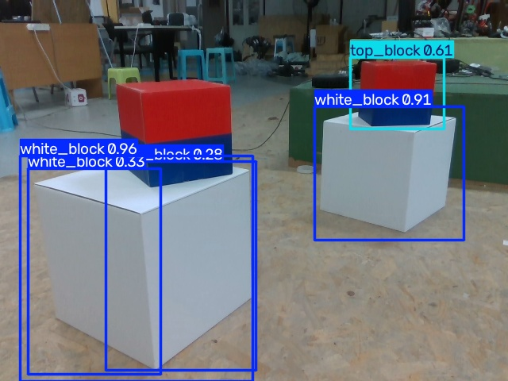

# Assignment 3 - YOLO 目标检测

## 1. 任务说明

本次作业选择 ROBOCON 2027 机器人竞赛中的方块作为目标检测对象，使用 Ultralytics YOLO11 训练自定义目标检测模型。

本次实验的目标是：

- 理解 YOLO 目标检测的基本原理。
- 学习 YOLO 格式数据集的制作和使用。
- 使用预训练模型训练自己的方块检测模型。
- 使用训练后的模型检测图片，获取目标类别、边界框和置信度。
- 为后续 ROBOCON 队内赛的方块识别、塔顶检测和建塔状态识别积累经验。

## 2. 数据集

### 2.1 数据集基本信息

- 数据集名称：ROBOCON Blocks Seed V1
- 数据来源：ROBOCON 方块图片，人工标注
- 数据集总数：15 张
- 训练集：12 张
- 验证集：3 张

检测类别：

| 类别 ID | 类别名称        | 含义   |
| ----- | ----------- | ---- |
| 0     | white_block | 白色方块 |
| 1     | top_block   | 塔顶方块 |

### 2.2 数据集格式

使用 YOLO 目标检测格式。

`images` 用于保存图像，`labels` 用于保存图像对应的标注文件。

`train` 是训练集，用来更新模型参数。

`val` 是验证集，用于评估训练过程中模型的检测效果。

每个目标的标签格式为：

```text
class_id x_center y_center width height
```

其中类别编号用于确定目标类型，后四项为归一化后的检测框中心坐标和宽高。

## 3. 模型训练

### 3.1 训练环境

- 操作系统：Ubuntu
- Python：3.12.3
- PyTorch：2.13.0+cu130
- CUDA Runtime：13.0
- GPU：NVIDIA GeForce RTX 5070 Ti Laptop GPU
- 深度学习工具：Ultralytics

### 3.2 模型选择

本次使用 YOLO11n 目标检测模型，加载官方预训练权重 `yolo11n.pt`。

YOLO11n 参数量较小、计算需求相对较低，适合作为第一次目标检测训练的入门模型。

### 3.3 实际训练命令

在项目目录 `/home/zhy/Projects/robocon_yolo` 中运行：

```bash
yolo detect train \
    model=yolo11n.pt \
    data=datasets/blocks_seed/data.yaml \
    epochs=50 \
    imgsz=640 \
    batch=8 \
    device=0 \
    workers=2 \
    project=runs \
    name=blocks_seed_v1
```

### 3.4 主要训练参数

| 参数      | 数值         | 作用               |
| ------- | ---------- | ---------------- |
| model   | yolo11n.pt | 使用预训练权重          |
| epochs  | 50         | 完整遍历训练集 50 次     |
| imgsz   | 640        | 训练输入图像尺寸         |
| batch   | 8          | 每批处理 8 张图片       |
| device  | 0          | 使用第一块 NVIDIA GPU |
| workers | 2          | 数据加载工作进程数        |

训练完成后，模型权重保存在：

```text
runs/detect/runs/blocks_seed_v1/weights/best.pt
```

`best.pt` 是训练期间依据验证表现选出的模型权重，可用于后续检测。

## 4. 训练结果与模型测试

### 4.1 验证结果

训练结束后的验证指标记录如下：

| 指标        | 结果    |
| --------- | ----- |
| Precision | 0.835 |
| Recall    | 0.884 |
| mAP50     | 0.984 |
| mAP50-95  | 0.802 |

模型已经完成训练并生成了可使用的权重文件。

### 4.2 实际检测效果

在初步使用模型检测方块时，模型能够大致识别部分目标，但也发现以下问题：

1. 个别检测框与实际方块边缘存在偏差。
2. 部分背景区域出现误检。
3. 模型在复杂场景中的泛化能力仍需提高。

由于当前数据集仅有 15 张图片，其中验证集只有 3 张，所以验证指标不能充分代表模型在真实比赛场景下的表现。

### 4.3 使用训练后的模型进行推理

本次使用自行训练得到的 YOLO11n 权重 `best.pt`，对数据集中的一张验证图片进行目标检测。

实际推理命令如下：

```bash
yolo detect predict \
    model=runs/detect/runs/blocks_seed_v1/weights/best.pt \
    source=datasets/blocks_seed/images/val/20261015_172854_2a279b43_000028.jpg \
    conf=0.25 \
    save=True \
    project=runs/assignment3 \
    name=predict \
    exist_ok=True
```

本次推理使用 NVIDIA GeForce RTX 5070 Ti Laptop GPU。

检测结果：

- 检测到 4 个 `white_blocks`。
- 检测到 1 个 `top_block`。
- 神经网络推理耗时为 2.8 ms（不包含预处理和后处理）。
- 检测结果保存在 `results/result.jpg`。



本次测试说明自行训练得到的 YOLO 模型已经能够进行目标检测。但由于测试图片来自验证集，且数据集较小，模型在其他比赛环境中的泛化能力仍有待验证。


**注意：提交作业前需要实际生成这张图片。**

## 5. 对 YOLO 的理解

### 5.1 YOLO 是用来做什么的？

YOLO 是一种目标检测方法，能够识别图像中有哪些目标，并预测目标的位置和类别。

### 5.2 什么是 Bounding Box？

Bounding Box 是边界框，用矩形表示目标在图片中的位置和范围。

常见表示方式包括中心坐标加宽高，或者左上角与右下角坐标。

### 5.3 什么是 Confidence？

Confidence 是模型对某个检测结果给出的置信分数。

分数越高通常表示模型对该检测判断越有信心，但不代表检测一定正确。

### 5.4 Training 和 Predict 有什么区别？

Training 是训练过程。

训练时，模型通过带标注的数据计算损失，利用反向传播和优化器调整网络参数。

Predict 是推理过程。

推理时，使用训练好的模型对新图片进行预测，通常不再更新模型参数。

### 5.5 训练得到的 .pt 文件是什么？

`.pt` 文件是 PyTorch 格式的模型文件。

本次训练得到的 `best.pt` 保存了训练后的模型权重及相关信息，可供后续加载和目标检测使用。

## 6. 总结与改进方向

本次实验使用 15 张人工标注的 ROBOCON 方块图片，成功训练了 YOLO11n 自定义目标检测模型，初步掌握了数据集准备、预训练权重、模型训练和结果分析的流程。

本次实验也发现，小规模数据集容易出现验证结果不稳定以及模型泛化能力不足的问题。

后续计划：

- 扩充真实比赛方块数据集。
- 加入多角度、多距离和不同光照下的图片。
- 增加多方块堆叠、塔顶与复杂背景场景。
- 改进数据标注质量，重新训练并比较模型效果。
- 结合 OpenCV 与 RealSense，进一步研究方块定位和建塔状态识别。
